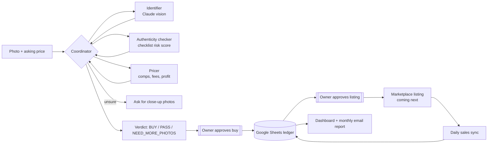

# E-commerce AI Agent

A multi-agent AI workflow and MCP server that runs the back office of a small e-commerce business selling used electronics (mainly cameras and high-end audio).

One product photo goes in. A **buy/pass verdict**, an **authenticity risk score** and, once approved, a **ledger entry and marketplace listing** come out. A person approves every purchase and every listing before anything is written or published.

**[Try the interactive demo dashboard →](https://claude.ai/artifact/NPbB5e2PjgggNL3raX9Sn9)** Filter by category or month, and test the agent's buy/pass pricing logic yourself. Sample data only.

> **Status:** v0.1. The ledger, reports, import and reconciliation, approval gate, photo-to-verdict agent and MCP server all work today on a demo ledger. Live marketplace integration (listing and pricing APIs) is next, waiting on developer account approval. See [ROADMAP.md](ROADMAP.md).

---

## Why I built it

Every item the business sells used to take the same manual steps: identify the model, check comps, judge authenticity, write the listing, log the cost for taxes. Each step was slow and inconsistent, and a missed fake or an overpriced buy cost real margin. Cost records lived in scattered places.

The goal was to cut that manual time while keeping a human in control of every action that spends money or touches the seller account. I ran it like a program: a PRD, a risk register, an evaluation plan with a launch gate, and milestones. See the [product requirements overview](docs/product-requirements.md). The full PRD is available on request.

## How it works



| Agent | Job | How |
|---|---|---|
| Coordinator | Routes work, asks for more photos when unsure, assembles the verdict | `agent/verdict.py` → `decide()` |
| Identifier | Brand, model, variant, visible condition; one observation per authenticity check | Claude vision with a forced structured-output tool |
| Authenticity checker | 0–100 risk score with reasons and the close-ups that would settle it | Weighted per-category checklists. The repo ships generic starters. Brand-specific checklists stay private in `data/private/` (git-ignored) |
| Pricer | Expected sale price, profit after fees and shipping, max buy price | `pricing.py` (pure, unit-tested) |
| Lister | Title, item specifics, description, price | Next milestone (marketplace listing API) |

### Safeguards

The biggest risk is a confident wrong answer: a missed fake, or a made-up spec in a listing. The design targets that directly:

- **Never "authentic", only risk.** The agent reports observations per checklist item. Checks it can't see count as *unclear*, so a blurry photo can't produce a low-risk score by saying nothing.
- **Unsure means more photos, not a guess.** Low identification confidence or unresolved checks return `NEED_MORE_PHOTOS`.
- **Thin data is flagged.** Fewer than 5 price comps is called out in the verdict.
- **The agent can propose but not commit.** MCP write tools only stage a change. A person commits it with `ecom-agent approve <id>`, a channel the model has no tool for.
- **Full audit trail.** Every proposal, approval and rejection is written to an `ActionLog` tab.
- **Secrets stay out of code and the sheet.** Credentials come from environment variables. Real business data is never committed. This repo ships a synthetic demo ledger.

## Reporting beyond the marketplace's own

Marketplace reports show sales and fees. They don't know what you paid for an item, where you bought it, or what you spent on supplies and mileage. The ledger joins all of that:

| Report | Question it answers |
|---|---|
| True profit per item | What did each item earn after cost, fees, shipping and refunds? |
| Return by category | Profit per $100 spent, and how fast each category sells |
| Best sourcing channels | Which places to buy produce the most profit and fastest sales? |
| Inventory aging | How much cash sits in unsold stock at 30, 60 and 90+ days? |
| Monthly summary | Revenue, gross and net profit after expenses and mileage |

The real ledger covers January to November 2026: 85 orders, reconciled to the marketplace's financial records.

## Quick start (demo data, no API keys needed)

```bash
git clone https://github.com/eduardoslife/ecommerce-ai-agent
cd ecommerce-ai-agent
pip install -e ".[dev]"
pytest                                   # 14 tests

# Import a marketplace transaction report and reconcile it
ecom-agent import data/sample/marketplace_transaction_report_sample.csv

# Business reports
ecom-agent report month 2026-10
ecom-agent report sources
ecom-agent report aging

# Buy/pass verdict from a saved identification (offline)
ecom-agent verdict --identification data/sample/identification_example.json \
    --asking 150 --comps 340,355,310,375,365,330
```

Example verdict:

```json
{
  "decision": "BUY",
  "item": "Nikon FM2 chrome body",
  "expected_sale": 347.5,
  "comp_range": "$310-$375",
  "profit_at_asking": 134.84,
  "max_buy_price": 244.84,
  "risk_level": "low",
  "closeups_needed": ["Lens glass free of visible fungus, haze, separation or deep scratches"]
}
```

With an `ANTHROPIC_API_KEY` set, pass a real photo instead: `ecom-agent verdict photo.jpg --asking 150 --comps 340,355,310`.

## Use it from Claude (MCP)

```bash
ecom-agent serve
```

Add it to Claude Desktop or Claude Code (see [docs/claude_desktop_config.example.json](docs/claude_desktop_config.example.json)), then ask things like *"What's aging past 60 days?"*, *"Which sourcing channel made the most money?"* or *"Log this purchase"*. The last one comes back as a pending action for you to approve.

| Read tools | Propose-only tools (need owner approval) |
|---|---|
| `list_inventory`, `profit_by_item`, `return_by_category`, `best_sourcing_channels`, `inventory_aging`, `monthly_summary`, `evaluate_deal`, `pending_approvals` | `propose_purchase`, `propose_expense`, `propose_mark_listed` |

## Connect the real Google Sheet

1. Create a Google Cloud service account and download its JSON key.
2. Share the ledger sheet with the service account's email as Editor.
3. Set the environment variables `LEDGER_BACKEND=sheets`, `GOOGLE_SHEET_ID` and `GOOGLE_APPLICATION_CREDENTIALS` (see `.env.example`).

## Project layout

```
src/ecom_agent/
  agent/verdict.py        coordinator, identifier (Claude vision), CLI
  agent/authenticity.py   checklist-based risk scoring
  pricing.py              fees, comps, profit, max buy price
  importers.py            marketplace transaction report import + reconciliation
  approvals.py            human approval gate + audit log
  ledger/                 schema, CSV and Google Sheets backends, reports
  mcp_server.py           MCP server (read tools + propose-only write tools)
  cli.py                  ecom-agent command
data/checklists/          generic starter authenticity checklists
data/private/             real checklists (git-ignored, not in this repo)
data/sample/              synthetic demo ledger (all numbers made up)
docs/                     architecture, product requirements overview
tests/                    unit tests
```

## Built with

Python · [Model Context Protocol](https://modelcontextprotocol.io) · Claude (Anthropic API) · Google Sheets API · Claude Code

## License

MIT
