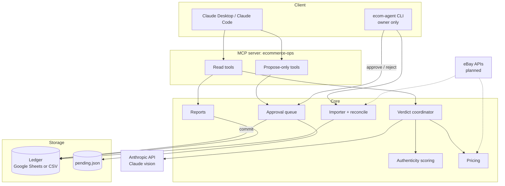

# Architecture

## Components

## Design decisions

**The model proposes, a person commits.** Write tools exposed over MCP only add an entry to a local approval queue. Committing happens in the CLI, which the model has no tool for. MCP clients also prompt before tool calls, but that alone relies on the client. The queue makes the gate part of the system itself, and every step lands in an audit log.

**Observations, not verdicts, from the model.** The Identifier reports pass, unclear or concern for each checklist item. Scoring is plain code, so it's deterministic, testable and easy to tune from evaluation results. Skipped checks count as unclear, so silence can't lower the risk score.

**Structured output by forced tool call.** The vision call uses `tool_choice` to force a single `report_identification` tool. The response is always schema-shaped JSON, with no free-text parsing.

**One ledger schema, two backends.** The CSV backend runs the demo and tests with no credentials. The Google Sheets backend is production. Reports and tools don't know which one they're using.

**Reconcile on every import.** The importer compares the ledger's net total with the marketplace report and, optionally, the Financial Summary total. Unmatched refunds or shipping labels are surfaced instead of silently dropped.

**Pricing is pure.** Fees, comp statistics, profit and max buy price are pure functions with configurable fee assumptions, unit-tested in isolation.

## Known limits (v0.1)
- eBay restricts access to sold-price history, so v1 uses active listings plus the business's own sales records once the API is connected. Until then, comps are entered by hand.
- The public authenticity checklists are generic starters. Production checklists are brand-specific and kept out of the repo.
- The fee model uses configurable defaults. Check your own category's rates.
